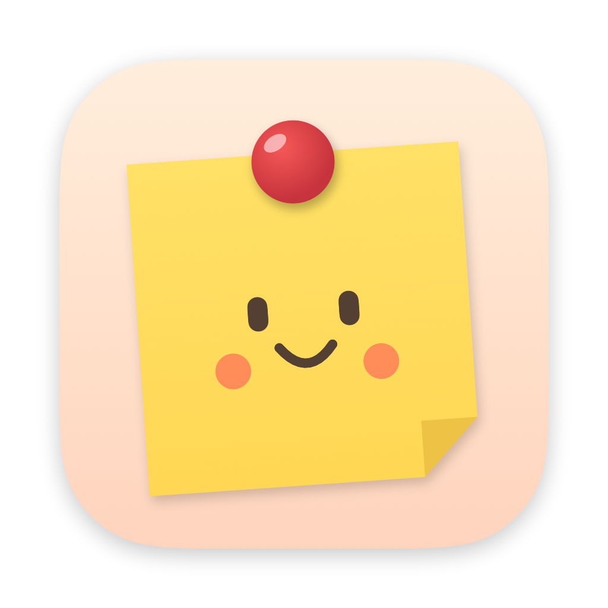

<p align="center">
  
</p>

<h1 align="center">Tackie</h1>

<p align="center">
  A tiny sticky note for your Mac that floats on top: your to-dos, reminders and quick notes, always one glance away.
</p>

<!-- Screenshot: replace with a real one, e.g. docs/screenshot.png
<p align="center"></p>
-->

## Why

The built-in Reminders and Notes apps are great, but they're full windows you have to go and find. Tackie is a small note pinned to the corner of your screen. Check something off, jot down a line in a meeting, and get back to work.

## Features

- **Floats where you can see it.** It stays above other windows on every desktop, including over full-screen apps. Unpin it any time so it behaves like a normal window.
- **To-dos, typed in place.** Click the empty row and type; Return adds the item and starts the next one.
- **Reminders from plain text.** Write "call mom at 5pm" or "pay rent tomorrow 9am" and the reminder is set for you. When it's due, a card pops up with **Done**, **Snooze** and **Tomorrow** buttons.
- **Quick notes.** Press **⌃⌥N** from any app and start typing. Notes save as you type.
- **Share anywhere.** Send a note with AirDrop, Mail or Messages, copy it, or save it as a Markdown file.
- **Make it yours.** Sticky colors or see-through glass, opacity, text size, and fonts, including handwriting styles.
- **Light.** A menu-bar app with no Dock icon, no account and no internet connection. Your data stays on your Mac.

## Install

1. Download **Tackie.zip** from the [latest release](../../releases/latest), unzip it, and move **Tackie.app** to your Applications folder.
2. Open it. Because Tackie isn't signed by a registered Apple developer, macOS will block it the first time. Go to **System Settings → Privacy & Security**, scroll down, and click **Open Anyway** next to the message about Tackie.

Requires macOS 13 or later on an Apple silicon Mac.

### Build from source

With Xcode or the Xcode Command Line Tools installed (`xcode-select --install`):

```bash
git clone <this repo>
cd tackie
./build.sh install    # builds Tackie.app, copies it to /Applications, and opens it
```

`./build.sh` on its own just builds `build/Tackie.app`.

## Using Tackie

| | |
| --- | --- |
| Show or hide the note | **⌃⌥T** from anywhere, or click Tackie in the menu bar |
| New quick note | **⌃⌥N** from anywhere |
| Switch tabs | Click **To-do** / **Notes**, or **⌘1** / **⌘2** |
| Add a to-do or note | Type in the empty row, or press **⌘N** |
| Add several to-dos at once | Paste a list into the empty row (one to-do per line) |
| Edit a to-do | Double-click it. Changing the time in the text moves its reminder |
| Change a reminder | Click the 🔔 time under a to-do, or right-click it |
| Keep on top or not | The 📌 button in the header |
| Colors, fonts, text size and more | The **⋯** button in the header |
| Bigger / smaller text | **⌘+** / **⌘−** (**⌘0** resets) |
| Start at login | Menu bar → **Open at Login** |

Reminder pop-ups can be turned off in **⋯ → Reminder Alerts**.

## Your data

Everything is stored locally in `~/Library/Application Support/Tackie/`. Tackie never connects to the internet.

## License

[MIT](LICENSE)
